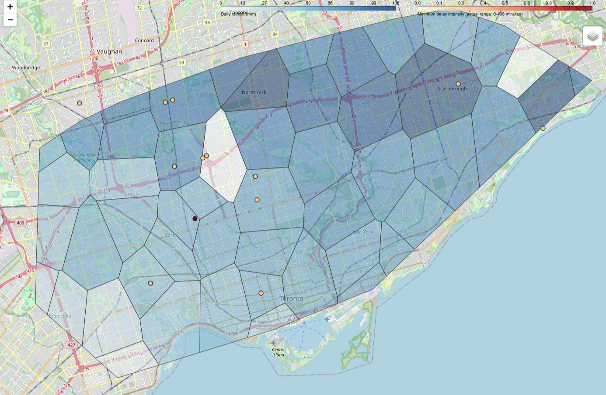
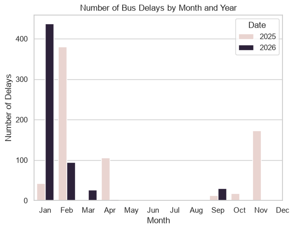

# Project Title

Predicting the Effects of Extreme Precipitation Events on TTC Operations


<div align="center">
<a href="(https://connieyqzhang.github.io/CME538-F26-Team05-TeamLoon/)">
  
</a>
  
  *Click the image to explore the live map*
</div>

---

## Overview
Extreme precipitation events have become more common in the City of Toronto over the past several years. In recent times, the city has been hit with several 100-year storms and numerous blizzards leading to multiple floods, and billions of dollars in infrastructure damage [1].

Using historical TTC delay records, GTFS transit data, rain gauge measurements, and weather forecasts, this project aims to identify vulnerable transit infrastructure, quantify the relationship between precipitation and service disruptions, and develop predictive tools that can help TTC users and planners  prepare for future weather related delays.

---
## Research Question
Given the magnitude and duration of a precipitation event, which routes and stations within the TTC are most likely experience delays, and what will the delay duration be?

Additionally:
- What areas and routes are most effected by these delays
- How do different transit modes respond to severe precipitation events?

---

## Dataset(s)

| Dataset                               | Source            | Description                                                                    | Time Period | Source                                                                  |
| ------------------------------------- | ----------------- | ------------------------------------------------------------------------------ | ----------- | ----------------------------------------------------------------------- |
| TTC GTFS Realtime Service Disruptions | Open Data Toronto | Real-time delay information including location, delay start time, and duration | Real-time   | https://open.toronto.ca/dataset/ttc-gtfs-realtime-gtfs-rt/              |
| TTC GTFS Routes and Schedules         | Open Data Toronto | Route geometry, schedules, and stop information                                | 2026        | https://open.toronto.ca/dataset/merged-gtfs-ttc-routes-and-schedules/   |
| TTC Bus Delay Data                    | Open Data Toronto | Historical bus delays and locations                                            | 2014-2026   | https://open.toronto.ca/dataset/ttc-bus-delay-data/                     |
| TTC Streetcar Delay Data              | Open Data Toronto | Historical streetcar delays and locations                                      | 2014-2026   | https://open.toronto.ca/dataset/ttc-streetcar-delay-data/               |
| TTC LRT Delay Data                    | Open Data Toronto | Historical LRT delays and locations                                            | 2014-2026   | https://open.toronto.ca/dataset/ttc-lrt-delay-data/                     |
| TTC Subway Delay Data                 | Open Data Toronto | Historical subway delays and locations                                         | 2014-2026   | https://open.toronto.ca/dataset/ttc-subway-delay-data/                  |
| Toronto Rain Gauge Data               | Open Data Toronto | Historical precipitation measurements from rain gauges                         | 2014-2026   | https://open.toronto.ca/dataset/rain-gauge-locations-and-precipitation/ |
| Open-Meteo API                        | Open-Meteo        | Real-time and forecast weather data                                            | Real-time   | https://open-meteo.com/en/features                                      |
These datasets provide both geographic and temporal information required to link weather conditions with TTC service disruptions.

---

## Results

Expected outcomes include:
- Identification of TTC routes and stations most vulnerable to extreme precipitation.
- Heatmaps and geospatial visualizations showing disruption hotspots.

  
- Statistical analysis quantifying relationships between weather severity and service delays.

  
- Predictive models capable of forecasting weather-related disruptions.
- Interactive dashboards displaying current weather conditions, delays, and future risk.


The preliminary findings demonstrate that most delays occur within the fall and winter months of the year. 

---

## Methodology

Project workflow:

1. Data Collection
    - Gather TTC delay datasets, GTFS route data, weather observations, and forecasts.
2. Data Preparation
    - Standardize timestamps and coordinate systems.
    - Clean missing and inconsistent records.
    - Match stations and routes across datasets.
3. Geospatial Integration
    - Construct Thiessen polygons for rainfall coverage.
    - Associate precipitation data with TTC routes and stations.
4. Exploratory Data Analysis
    - Delay distributions.
    - Weather intensity analysis.
    - Geographic hotspot identification.
5. Predictive Modeling
    - Train machine-learning models to predict disruption probability and duration.
6. Evaluation
    - Validate using time-based train/test splits.
7. Visualization and Dashboard Development
    - Build an interactive Streamlit dashboard for real-time delay prediction and infrastructure risk assessment.
---
## Quick Start

Access the interactive map sample and demo report within the deliverables folder. The current code base is provided in the notebooks folder.

---

## Running the Project

Prerequisites:

- Python 3.11+
- Pandas
- GeoPandas
- NumPy
- Scikit-Learn
- Matplotlib
- Seaborn
- Requests
- google.transit
- google.protobuf.json_format

General workflow:

```bash
pip install -r requirements.txt
```

---

## Limitations

- Historical route alignments may differ from current TTC operations.
- Delay-cause classifications vary across years, with previous years being non-standardized.
- Correlation between weather and delays may not imply causation

---

## Future Work

Potential extensions include:
- Expanding the model to include temperature, flooding, and road conditions.
- Evaluating future climate scenarios using climate projections.
- Developing route recommendation systems for TTC riders.
- Integrating TTC service alerts and crowding data.

---

## References

[1] N. Howes, “One year later: How a billion-dollar flood exposed Toronto’s climate risk,” The Weather Network, Jul. 16, 2025. [Online]. Available: [https://www.theweathernetwork.com/en/news/weather/severe/one-year-later-how-a-billion-dollar-flood-exposed-torontos-climate-risk-july-16-2024](https://www.theweathernetwork.com/en/news/weather/severe/one-year-later-how-a-billion-dollar-flood-exposed-torontos-climate-risk-july-16-2024). [Accessed: Oct. 14, 2026].

