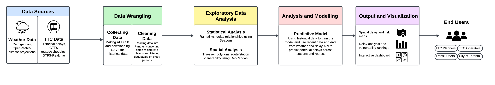

# 1.0 Predicting the effects of extreme precipitation events on TTC operations

**Figure 1: Project Architecture**

Extreme precipitation events have become more common in the City of Toronto over the past several years. In recent times, the city has been hit with several 100-year storms and numerous blizzards leading to multiple floods, and billions of dollars in infrastructure damage [1]. 

Most recently, on September 2nd 2026, Toronto was hit by a 100-year storm with 100 mm to 150 mm of rain encountered throughout the city [2]. Additionally, January 25th 2026 set the record for the snowiest day in Toronto history, with 61 cm of snow [3]. These extreme precipitation events are far from isolated and are becoming more and more frequent due to the effects of Climate Change [4]. In fact the maximum total daily precipitation within the City of Toronto is expected to increase by 18-27% by the 2080s [5]. 

In contrast, the City’s current infrastructure, most notably, its public transit infrastructure was not designed for these conditions. This has led to several service disruptions and delays on all types of public transit vehicles including subways (trains), buses and streetcars [6]. These issues disproportionately impact lower-income residents who do not have access to other modes of transportation [7]. The Toronto Transit Commission (TTC) has begun to recognize the various issues with its current system and has begun to prepare plans to address its shortcomings [6]. With that being said, there currently are no tools which allow users to plan their travel while being informed of anticipated weather related delays. 

This project aims to understand and predict the delays on Toronto public transit or TTC infrastructure caused by extreme precipitation events. The study will: 

1. Analyze historical weather and TTC service disruption data to understand the location and duration of disruption
2. Create a dashboard which uses live weather data and weather forecasts to predict the location and duration of service disruptions, allowing users to plan their trips accordingly. 
3. Use climate change models to identify which stations, modes of travel and routes require upgrades. 
# 2.0 Model Objectives and Research Questions

The model aims to identify the location and the duration of a TTC delay based on the magnitude of an extreme precipitation event. The primary research question which will be answered is: “Given the magnitude, duration and intensity of a precipitation event, which routes or stations within the Toronto transit system are most likely to experience a service disruption? And what is the disruption duration?”

The project also aims to explore the following questions:
1. What are the top causes of weather related delays per mode of transport (subway, streetcar, bus)?
2. Which stations, tracks or routes experienced the most delays during extreme precipitation events? 
3. How do buses, streetcars and subways respond to extreme precipitation events? 
4. Is there a relationship between the magnitude of the precipitation event and service delays? 
5. Is there a relationship between the location of a precipitation event and service delays?
6. How will the Toronto transit system be affected by extreme weather events brought on by climate change? 

The following factors will be considered for this analysis:
1. Precipitation (rain) 
2. Precipitation (snow)
3. Precipitation (Hail/Freezing Rain)
4. Wind
5. Time of day 
6. Day of Week 
7. Season 

Both live and historical datasets are available to support this analysis. Historical weather, live weather, and weather forecast data will all be used to make weather predictions. TTC historical and live service disruptions data is available for all three transportation modes. Section 5.0 provides additional detail on the datasets used. 
# 3.0 Background Review and Related Works

In July 2024 and February 2025 Toronto also saw extreme precipitation—namely, an extreme rainfall event and a blizzard. Following that, the TTC released a report on “Extreme Precipitation Planning” acknowledging the shortfalls in the TTC’s and City’s response to extreme weather [8, 9]. In their report, TTC identified the following issues:

1. Inadequate street and TTC station drainage
2. Poorly maintained drainage and pumping stations
3. Absence of snow clearing at transit stops

A study with a similar goal examined how rainfall relates to subway ridership within 116 stations in Manhattan, New York [10]. The researchers combined high resolution radar-based rainfall measurements with ridership records. A Bayesian multilevel linear regression model and a Markov Chain Monte Carlo sampling method was used to capture underlying parameter dependencies. The results showed that weekday ridership at stations in commercial areas was less sensitive to rainfall than at stations in residential areas. Although the study examined ridership rather than observed service delays, it provides a methodological reference for analyzing spatial and temporal relationships between weather and transit activity.

As a more relevant resource for Toronto, the TTC Subway Delays: Reliability Analysis dashboard provides a reference for examining subway delays alongside factors such as temperature and seasonality [11]. However, the dashboard is missing the spatial and temporal distribution of precipitation as well as above-ground infrastructure which this project aims to supplement.
# 4.0 Stakeholders and Engineering Impacts

This project has several stakeholders who would benefit from both the analysis and predictions of how extreme precipitation affects TTC reliability. As mentioned in the project statement, identifying which stations are susceptible can be useful for both day-to-day travel decisions and long-term infrastructure resilience planning. The table below details stakeholders who may use, benefit from, or be affected by the project.

**Table 1: List of Affected Stakeholders**

| Stakeholder                         | Effect                                                                                                                                                                                                                                                                                                                       |
| ----------------------------------- | ---------------------------------------------------------------------------------------------------------------------------------------------------------------------------------------------------------------------------------------------------------------------------------------------------------------------------- |
| Public TTC Users                    | TTC passengers can use the projected delays to make more informed travel decisions (like planning alternative transit routes or adjusting departure times) when they are anticipating a heavy precipitation event.                                                                                                           |
| Toronto Transit Commission Planners | Following a big precipitation event in 2024, the TTC released a risk mitigation plan specifically for extreme precipitation measures. TTC decision-makers could use the project's findings to identify which specific stations are required for further investigation, infrastructure improvements and contingency planning. |
| TTC Operators                       | Bus, streetcar, subway, and LRT operators may benefit from knowing which locations are highly affected in the case of service adjustments. As mentioned in the Background Review, lower-income residents will benefit from more prioritization of especially precipitation-vulnerable stations.                              |
| City of Toronto                     | The City could use the findings to support their National Adaptation Strategy’s goal of ensuring that infrastructure is resilient to climate change [12]. This project's findings could help guide further assessments of municipal drainage systems and transportation corridors.                                           |
# 5.0 Dataset Description

The following section will explore the data set sources to be used, and potential challenges that may occur.

## 5.1 Dataset Table

The model will require both spatial and temporal data for precipitation, TTC routes and delays. Table 2 below describes the data sources, collection methods and data types.

**Table 2: Dataset Sources for Model**

| Data Source                               | Collection Method | Data type                         | Important Variables                            | Geographic or temporal? | Justification                                                | Link                                                                                                                                               |
| ----------------------------------------- | ----------------- | --------------------------------- | ---------------------------------------------- | ----------------------- | ------------------------------------------------------------ | -------------------------------------------------------------------------------------------------------------------------------------------------- |
| TTC GTFS Realtime Service Disruptions     | Access API        | Sensor data                       | Start time, length of delay, location of delay | Geographic and temporal | Get real-time delay information for future delay predictions | [https://open.toronto.ca/dataset/ttc-gtfs-realtime-gtfs-rt/](https://open.toronto.ca/dataset/ttc-gtfs-realtime-gtfs-rt/)                           |
| TTC GTFS  Merged Route and Schedule | Download CSV      | Public data base                  | Route codes, route shape files                 | Geographic and temporal | Connect delays to routes/stations/geography                  | [https://open.toronto.ca/dataset/merged-gtfs-ttc-routes-and-schedules/](https://open.toronto.ca/dataset/merged-gtfs-ttc-routes-and-schedules/)     |
| TTC Bus Delay Data                        | Download CSV      | Public data base from sensor data | Start time, length of delay, location of delay | Geographic and temporal | Measure bus service response                                 | [https://open.toronto.ca/dataset/ttc-bus-delay-data/](https://open.toronto.ca/dataset/ttc-bus-delay-data/)                                         |
| TTC Streetcar Delay Data                  | Download CSV      | Public data base from sensor data | Start time, length of delay, location of delay | Geographic and temporal | Measure streetcar response                                   | [https://open.toronto.ca/dataset/ttc-streetcar-delay-data/](https://open.toronto.ca/dataset/ttc-streetcar-delay-data/)                             |
| TTC LRT Delay Data                        | Download CSV      | Public data base from sensor data | Start time, length of delay, location of delay | Geographic and temporal | Measure LRT response                                         | [https://open.toronto.ca/dataset/ttc-lrt-delay-data/](https://open.toronto.ca/dataset/ttc-lrt-delay-data/)                                         |
| TTC Subway Delay Data                     | Download CSV      | Public data base from sensor data | Start time, length of delay, location of delay | Geographic and temporal | Measure subway response                                      | [https://open.toronto.ca/dataset/ttc-subway-delay-data/](https://open.toronto.ca/dataset/ttc-subway-delay-data/)                                   |
| Toronto Rain Guage                        | Download CSV      | Sensor data                       | Precipitation amount, time, location           | Geographic and temporal | Measure historical precipitation intensity and duration      | [https://open.toronto.ca/dataset/rain-gauge-locations-and-precipitation/](https://open.toronto.ca/dataset/rain-gauge-locations-and-precipitation/) |
| Open-meteo                                | Access API        | Sensor data                       | Precipitation amount, time, location           | Geographic and temporal | Get real time and projected weather conditions               | [https://open-meteo.com/en/features](https://open-meteo.com/en/features)                                                                           |

## 5.2 Challenges

The following table summarizes the expected challenges and proposed mitigation measures. 

**Table 3: Challenges and Mitigation Measures**

| Challenge                        | Mitigation Measure                                                                                                                                                                                                                                                                               |
| -------------------------------- | ------------------------------------------------------------------------------------------------------------------------------------------------------------------------------------------------------------------------------------------------------------------------------------------------ |
| Spatial resolution mismatch      | Rain gauges are point measurements, while delays occur along routes.                                                                                                                                                                                                                             |
| Data types and formats           | Timestamps and coordinates arrive as text and must be converted to datetime and geometry objects. Units and time zones will be standardized. We will match different station names if the stations were inputted incorrectly (such as typos).                                                    |
| Missing values and gauge outages | We will flag gaps and exclude or impute periods with missing gauge data, with the approach documented.                                                                                                                                                                                           |
| Changing routes and schedules    | Since there is extensive historical data, routes may have changed and stops might no longer exist. We will have to locate these routes and stations and generalize their location (such as by geographical coordinates) so they can be compared with existing stations and rain gauge locations. |
| Delay-cause coding               | Delay codes are inconsistent across modes. We will normalize the delay codes and check if weather-related codes exist for the different datasets.                                                                                                                                                |
| Live vs. historical data         | GTFS-Realtime is a live feed, so historical training will rely on the historical delay CSVs. The live feed supports prediction only. We will need to put these two data sources into the same format.                                                                                            |
# 6.0 Data Science Approach

Our planned approach for transforming data into meaningful engineering insights includes TTC delay data and rain gauge data. Both historical and live data will be integrated. The historical data will be used primarily for exploratory analysis, model creation, and model training. Live data will be used to support predictions and for creating an interactive dashboard.
## 6.1 Data Collection, Integration, and Preprocessing

Table 4 outlines data collection and cleaning preprocessing for data supplied by the TTC and rain gauge database.

**Table 4: Data collection and preprocessing summary**

| Dataset                               | Collection                                      | Preprocessing                                                                                                                                                |
| ------------------------------------- | ----------------------------------------------- | ------------------------------------------------------------------------------------------------------------------------------------------------------------ |
| TTC Delay Data                        | Read CSV provided by Open Data Toronto          | Create Pandas dataframe from CSV. Convert datatime columns to Pandas datetime objects. Filter data based on study period.                                    |
| TTC GTFS Realtime Service Disruptions | Read API provided by Open Data Toronto          | Create Pandas dataframe from API call through google GTFRS library. Convert datatime columns toPandas datetime objects. Filter data based on study period.   |
| Rain Gauge Data                       | Read the TXT file provided by Open Data Toronto | Build Thessian polygons based on hydrology methods and assign a precipitation value per polygon based on rain gauge data. Filter data based on study period. |

The study period will be determined based on days with “long-duration precipitation” defined by TTC guidelines. The datasets will be aligned by time and geographic features to enable analysis between precipitation and delay.

### 6.2 Exploratory Data Analysis and Visualization

A combination of Pandas, GeoPandas, and Seaborn will be utilized throughout exploratory data analysis and initial visualizations. This will include analysing delay distribution, delay vs. rainfall intensity, and heat maps for precipitation by polygon. Streamlit will be utilized to create an interactive dashboard as the final deliverable.

### 6.3 Statistical Analysis and Machine Learning

Statistical analysis will be used to define a clear relationship of precipitation intensity in a specific area with delay. If there is a predictive relationship, machine-models may be used to predict the delay function or duration based on precipitation. A model such as random forest would be trained on the historical data to predict the delay duration per polygon. The product will be compared to a simple baseline and the current weather and the current delays.

### 6.4 Method Justification

The selected approaches are suitable for this engineering problem because it directly combines and analyses TTC delay data and extreme precipitation events. By integrating these dataset, we will be able to predict the precipitation associated with increased delays on a per route resolution. This is invaluable for understanding where TTC infrastructure and services are most vulnerable to extreme precipitation. The results can be used to identify priority locations for precipitation resilience measures and support more informed infrastructure and operational planning.
# 7.0 Evaluation and Success Criteria

The success of the project will be determined based on the following criteria:

1. **Identification of statistically significant relationships:** There is a quantifiable statistical relationship between delays and extreme precipitation events that is elevated when compared with normal-weather periods and that relationship
2. **Identification of Vulnerable Areas:** There are geographic areas, stations, or routes that are identified to be more vulnerable to delays from precipitation related events. This would include stations that experience a greater frequency or severity of delays. 
3. **Predictive Model Performance:** The model is able to correctly predict historic delays and apply them to predicted delays based on weather events. This will be compared to a baseline model to determine prediction accuracy of adding weather related data. 

This evaluation approach is meaningful because the results from the model must be significant and accurate enough that the TTC would be able to inform their actions. Identifying statistical relationships and vulnerable areas would help the TTC understand where and under what weather conditions a delay would occur. If the model is unable to find a statistical relationship or define clear boundaries from vulnerable areas, that would not be helpful in managing the most vulnerable areas. This project will be considered successful if it produces reliable and actionable insights for the relationship between extreme precipitation events and TTC delays.
# 8.0 Project Plan and Team Organization

Section 8.0 describes the general project plan, team organization, communication and responsibilities. 
## 8.1 Division of Responsibilities

We will take a collaborative approach to this assignment. Every team member will both code and write the documentation. To ensure clear communication and responsibilities, we will have specialists for different tasks. Each member is a specialist who leads one area and teaches it to the others, so all members understand the full project.

**Table 5: Team Members and Roles**

| Team Member      | Specialist Responsibility                               |
| ---------------- | ------------------------------------------------------- |
| Dana Bou Saab    | Project Coordination, Documentation, Data Wrangling/EDA |
| Connie Zhang     | Documentation, Github Management and Data Wrangling/EDA |
| Nikita Chiduku   | Data Analysis and Modelling                             |
| Michelle DeLoyde | Prompt Engineering, Visualization and Data Analysis     |
## 8.2 Major Project Tasks

The major tasks:

1. Collect and clean precipitation and TTC delay data
2. Build Thiessen polygons and assign routes and stations
3. Normalize delays by scheduled service
4. Exploratory analysis and visualization
5. Statistical comparison of extreme vs. normal conditions
6. Optional predictive model and future-risk scenario
7. Final maps, ranking and recommendations
8. Final report and presentation
## 8.3 Expected Timeline

The following table summarizes the anticipated project timeline. 

**Table 6: Project Timeline**

| Date        | Event                  |
| ----------- | ---------------------- |
| October 14  | Project Proposal (1)   |
| October 25  | Project Checkpoint (2) |
| November 6  | Project Demo (3)       |
| November 30 | Final Presentations    |
| December 7  | Github Repo Submission |
## 8.4 Meeting Schedule

The team will meet weekly Thursdays from 12-3pm to work on the project. This day is optimal as it follows the previous day’s assignment deadline and precedes the Friday Tutorial meeting.

## 8.5 Communication Method

The team will communicate through iMessage and Discord for day-to-day communication. Every team member agrees to check the chat and will respond to messages in a timely manner. We will use GitHub for code. 
## 9. Risks and Mitigation

Below is a table identifying possible risks that may affect the project.

**Table 7: Potential Risks and Mitigation Strategies**

| Risk                                                                                               | Impact                                                              | Mitigation                                                                                                                                                               |
| -------------------------------------------------------------------------------------------------- | ------------------------------------------------------------------- | ------------------------------------------------------------------------------------------------------------------------------------------------------------------------ |
| Rain has little to no effect on service                                                            | Analysis in intended direction cannot proceed                       | Identify alternative data sources or causes of delays                                                                                                                    |
| Team member becomes unable to complete/work on the project                                         | The team cannot complete as much work as expected                   | Open and frequent communication about project timeline and expectations                                                                                                  |
| Project scope too large                                                                            | Difficult to complete within timeline                               | We will take a staged approach and expand the project as we progress. First we will analyze just surface TTC vehicles, then move on to LRT and the subway if time allows |
| Weather-related delay codes are rarely used or inconsistent                                        | Weather-caused delays are undercounted                              | We will not rely on the codes and rather use them only as a secondary check                                                                                              |
| Overfitting or data leakage from time-correlated data                                              | The model looks accurate on historical storms but fails on new ones | Use time-based train/test splits (not random), cross-validate by event, and compare against the baseline                                                                 |
| Version control and environment problems (merge conflicts, large CSVs, differing library versions) | Lost work or code that won’t run on everyone’s computers            | Maintain everything on GitHub only, and use feature branches and pull requests, share a requirements/environment file, and keep raw data out of the repo                 |

## 10. References

[1] N. Howes, “One year later: How a billion-dollar flood exposed Toronto’s climate risk,” The Weather Network, Jul. 16, 2025. [Online]. Available: [https://www.theweathernetwork.com/en/news/weather/severe/one-year-later-how-a-billion-dollar-flood-exposed-torontos-climate-risk-july-16-2024](https://www.theweathernetwork.com/en/news/weather/severe/one-year-later-how-a-billion-dollar-flood-exposed-torontos-climate-risk-july-16-2024). [Accessed: Oct. 14, 2026].

[2] I. Callan, “Toronto begins recovery after ‘100-year storm’ leaves behind massive flooding,” Global News, Sep. 3, 2026. [Online]. Available: [https://globalnews.ca/news/12046334/toronto-storm-recovery/](https://globalnews.ca/news/12046334/toronto-storm-recovery/). [Accessed: Oct. 14, 2026].

[3] “What a winter wallop: Storm sets new single-day snowfall record for Toronto,” CP24, Jan. 26, 2026. [Online]. Available: [https://www.cp24.com/local/toronto/2026/01/26/what-a-winter-wallop-storm-sets-new-single-day-snowfall-record-for-toronto/](https://www.cp24.com/local/toronto/2026/01/26/what-a-winter-wallop-storm-sets-new-single-day-snowfall-record-for-toronto/). [Accessed: Oct. 14, 2026].

[4] Center for Climate and Energy Solutions, “Extreme precipitation and climate change.” [Online]. Available: [https://www.c2es.org/content/extreme-precipitation-and-climate-change/](https://www.c2es.org/content/extreme-precipitation-and-climate-change/). [Accessed: Oct. 14, 2026].

[5] Toronto and Region Conservation Authority, Toronto’s Current and Future Climate. Prepared for the City of Toronto, 2024. [Online]. Available: [https://www.toronto.ca/wp-content/uploads/2024/12/949f-TorontosCurrentandFutureClimate-REPORT-Final.pdf](https://www.toronto.ca/wp-content/uploads/2024/12/949f-TorontosCurrentandFutureClimate-REPORT-Final.pdf). [Accessed: Oct. 14, 2026].

[6] Toronto Transit Commission, “Extreme precipitation planning,” background report to the TTC Board, 2025. [Online]. Available: [https://www.toronto.ca/legdocs/mmis/2025/ttc/bgrd/backgroundfile-254729.pdf](https://www.toronto.ca/legdocs/mmis/2025/ttc/bgrd/backgroundfile-254729.pdf). [Accessed: Oct. 14, 2026].

[7] G. Vendeville, “Stranded without transit? U of T researchers say one million urban Canadians suffer from ‘transport poverty’,” University of Toronto News, Jan. 9, 2019. [Online]. Available: [https://www.utoronto.ca/news/stranded-without-transit-u-t-researchers-say-one-million-canadians-suffer-transport-poverty](https://www.utoronto.ca/news/stranded-without-transit-u-t-researchers-say-one-million-canadians-suffer-transport-poverty). [Accessed: Oct. 14, 2026].

[8] “TTC board, extreme weather and precipitation planning report,” CBC News. [Online]. Available: [https://www.cbc.ca/news/canada/toronto/ttc-board-extreme-weather-precipitation-planning-report-1.7512420](https://www.cbc.ca/news/canada/toronto/ttc-board-extreme-weather-precipitation-planning-report-1.7512420). [Accessed: Oct. 14, 2026].

[9] Toronto Transit Commission, “TTC3.7—Extreme precipitation planning,” City of Toronto, Agenda Item History, Apr. 16, 2025. [Online]. Available: [https://secure.toronto.ca/council/agenda-item.do?item=2025.TTC3.7](https://secure.toronto.ca/council/agenda-item.do?item=2025.TTC3.7). [Accessed: Oct. 14, 2026].

[10] “Does demand for subway ridership in Manhattan depend on the rainfall events?” Transport Policy. [Online]. Available: [https://www.sciencedirect.com/science/article/abs/pii/S0967070X18301586](https://www.sciencedirect.com/science/article/abs/pii/S0967070X18301586). [Accessed: Oct. 14, 2026].

[11] “TTC transit reliability,” Streamlit. [Online]. Available: [https://ttc-transit-reliability-hitakshi.streamlit.app/](https://ttc-transit-reliability-hitakshi.streamlit.app/). [Accessed: Oct. 14, 2026].

[12] Housing, Infrastructure and Communities Canada, “Toronto Transit Commission (TTC) Streetcar Program.” [Online]. Available: [https://housing-infrastructure.canada.ca/pd-dp/seea-eees/ttc-streetcar-program-programme-tramways-eng.html](https://housing-infrastructure.canada.ca/pd-dp/seea-eees/ttc-streetcar-program-programme-tramways-eng.html). [Accessed: Oct. 14, 2026].
