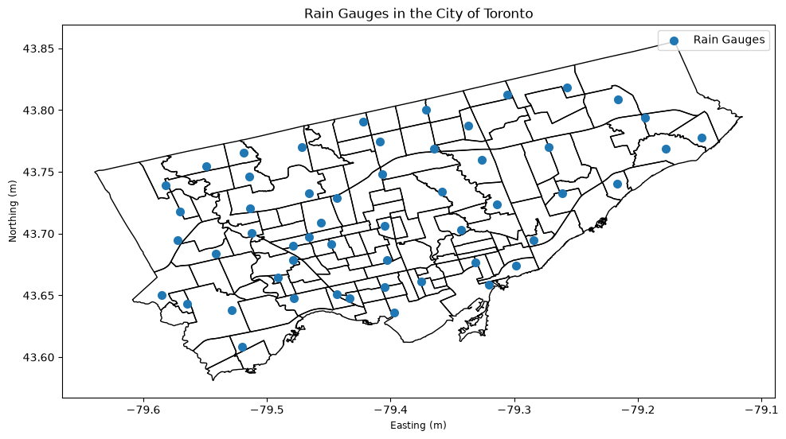
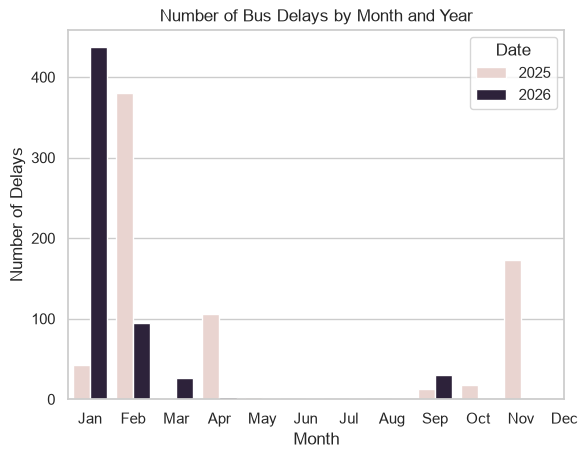
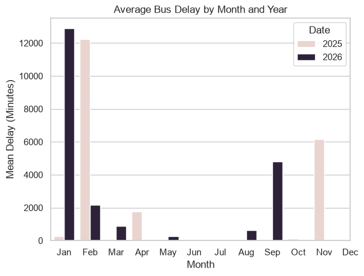
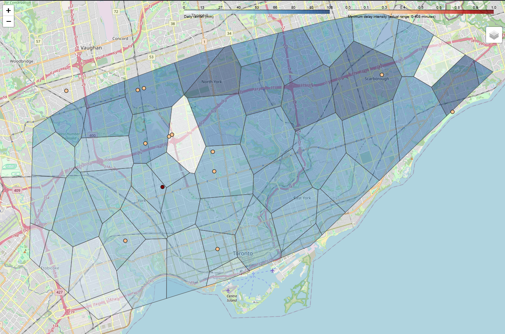
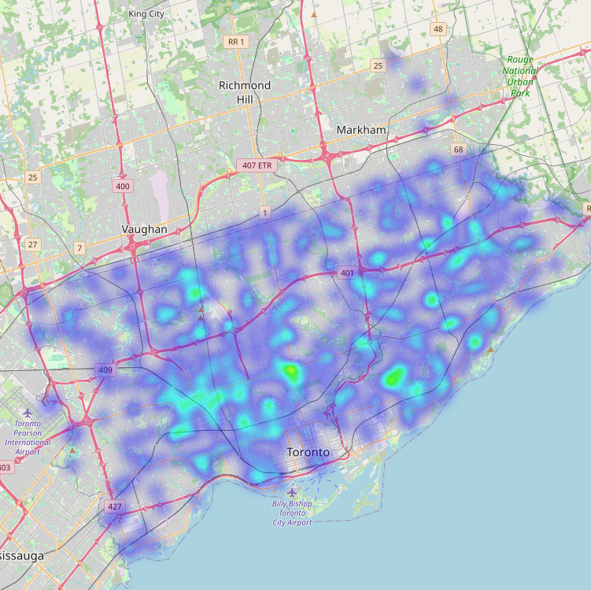
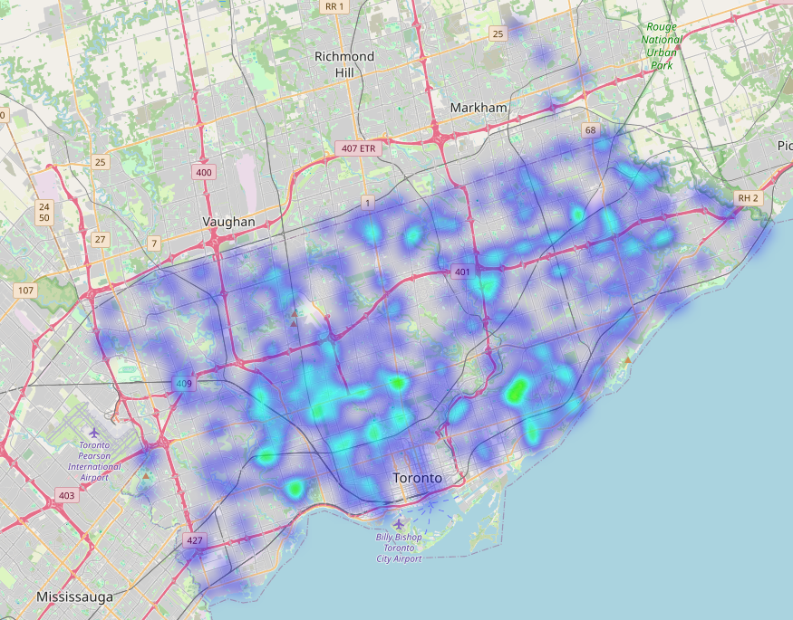
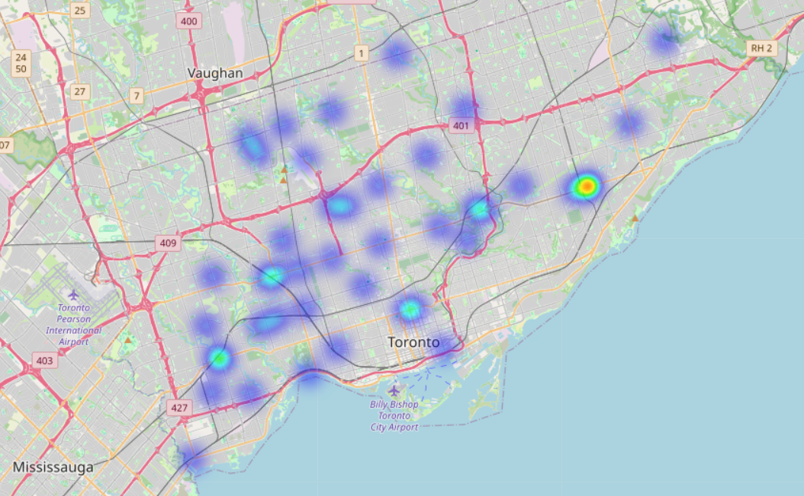
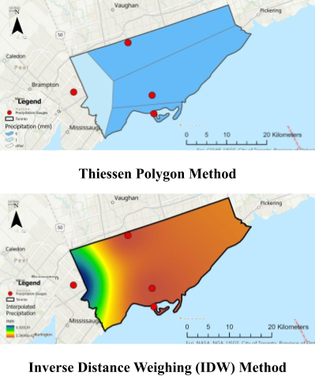

# 1.0 Project Progress Summary -  Predicting the effects of extreme precipitation events on TTC operations
Extreme precipitation events have become more common in the City of Toronto over the past several years. They have a major impact on public infrastructure particularly public transit or TTC infrastructure, causing major disruptions and delays. In Deliverable 1, the team proposed using Toronto Rain Gauge Data and TTC Delay Data to train a model to predict the magnitude and location of delay based on precipitation. The model will then be utilized in a dashboard which takes in live weather data to predict delays, allowing users to plan their trips accordingly. 

Since Deliverable 1, the team has worked to further investigate the data sources, and compile and clean the data into several dataframes. The team has also created several data visualizations including TTC delay heatmaps, and rain gauge location maps, and average rainfall maps, calculated using Thiessen polygons. 

The team encountered several data challenges including:

1. Inconsistencies in bus delay data over the years and the way in which TTC GTFS data describes routes and stops
2. Differences in the types of rain gauges owned by the City of Toronto and subsequently the reported precipitation depths

Data analysis details and challenges are further discussed in Section 2.0 Dataset Acquisition and Preparation, while data visualization is discussed in Section 3.0 Initial Analysis and Preliminary Results.

Our current progress is shown below: 

| Stage                     | Status        |
| ------------------------- | ------------- |
| Dataset acquisition       | Complete      |
| Data cleaning             | Complete      |
| Geospatial processing     | Complete      |
| Exploratory analysis      | Complete      |
| Delay-weather integration | Current stage |
| Model development         | Upcoming      |
| Dashboard integration     | Upcoming      |
| Final recommendations     | Upcoming      | 

[Rain gauge data →](../../notebooks/PrecipicationData.ipynb)

[Bus Delay date →](../../notebooks/Bus%20Delay/TTC%20Bus%20Delay%20Post%202025,2026.ipynb)

# 2.0 Dataset Acquisition and Preparation 
Historical Rain Gauge Data and TTC delay data included in Deliverable 1 were used. Table 1.0 summarises dataset source(s), how the data was obtained, dataset size and format, and important variables/features.

*Table 1.0: Dataset Summary*

| Dataset | Dataset source(s) | How the data was obtained | Dataset size and format | Important variables/features |
| ----- | :---- | :---- | :---- | :---- |
| Toronto Rain Gauge | [https\://open.toronto.ca/dataset/rain-gauge-locations-and-precipitation/](https://open.toronto.ca/dataset/rain-gauge-locations-and-precipitation/)  | Download CSV | 2019-2026 at 5 minute intervals. | Rain Gauge Number, and Rain Gauge Location, Precipitation (mm) |
| TTC Bus Delay Data | [https\://open.toronto.ca/dataset/ttc-bus-delay-data/](https://open.toronto.ca/dataset/ttc-bus-delay-data/)  | Accessed CSV through API call | 2014-2026 at a per delay level. | Start time, length of delay, location of delay |
| TTC GTFS Data | [https\://open.toronto.ca/dataset/merged-gtfs-ttc-routes-and-schedules/](https://open.toronto.ca/dataset/merged-gtfs-ttc-routes-and-schedules/)  | Accessed CSV through API call | Current TTC infrastructure | TTC stops, routes, shape files, schedules |
## 2.1 Historical Rain Gauge Data
Historical Rain Gauge Data between June 2015-Present was collected, cleaned and consolidated into several data frames. Before coding began, a data review was completed to understand what types of precipitation data each rain gauge is able to collect. It was found that rain gauges fell into two general categories:
1. Heated Rain Gauges: Heated Rain Gauges are capable of melting other types of precipitation such as snow and hail. As a result, they can operate year round. They report back a measurement of snowmelt, or the depth of snow in if it was in a liquid state.
2. Non-heated Rain Gauges: Non-heated Rain Gauges can only measure the depth of precipitation in liquid state, or in other words, just rain. They cannot operate in the winter.
The City of Toronto has:
-  3-Season Rain Gauges: 3-Season Rain Gauges are non-heated rain gauges. They are operable between April 1st and Oct 31st of every year. 
- 4-Season Rain Gauges: 3-Season Rain Gauges are heated rain gauges. They are operable year-round. 
Table 2.0 summarizes the 3-Season and 4-Season Rain Gauges. As shown, the vast majority of rain gauges are 3-Season gauges. 

*Table 2.0: 3-Season and 4-Season Rain Gauges*

| 3-Season Rain Gauges | RG_001, RG_002, RG_003, RG_004, RG_006, RG_007, RG_012, RG_013, RG_014, RG_015, RG_020, RG_021  RG_022, RG_023, RG_024, RG_025, RG_027, RG_028, RG_030, RG_031, RG_033, RG_034, RG_035, RG_036, RG_037, RG_039, RG_040, RG_041, RG_042, RG_044, RG_045, RG_046, RG_047, RG_048, RG_049, RG_050, RG_051, RG_052, RG_053 |
| -------------------- | ---------------------------------------------------------------------------------------------------------------------------------------------------------------------------------------------------------------------------------------------------------------------------------------------------------------------------- |
| 4-Season Rain Gauges | RG_016, RG_017, RG_018, RG_019, RG_038                                                                                                                                                                                                                                                                                       |

Firstly, all historical rain gauge csv files were read and consolidated into one dataframe called precipitation for initial review. It was found that the rain gauges recorded precipitation data in 5-minute increments. It was also found that the latitude and longitude values for each rain gauge were included in each row for each rainfall measurement. The rainfall data was checked for missing or NaN values but none were found. Research was completed on how the city documents broken or inactive rain gauges but no publicly available information was found. 

To minimize the size of the dataframe, the rain gauge name, latitude and longitude were moved into one separate dataframe as location data needed to be accessed one time. The result was a master dataframe named gauges. Using gauges, Figure 1.0 below was created. It shows the locations of all rain gauges within the city. gauges was later split into two different dataframes, one for 3-Season gauges and one for 4-Season gauges for analysis.

*Figure 1.0: Rain Gauges within the City of Toronto*

The precipitation dataframe was then transformed into a dataframe called rainfall_by_time. This dataframe uses the time as the index and the rain gauges as the columns. Both dataframes split based on dates: 
1. April 1st to October 31st: Since this time period is assumed to have rain (liquid precipitation), all rain gauges should be turned on and all data is relevant. 
2. November 1st to March 31st: 4-Season Rain gauge values are the only ones applicable for this time period. 

Following the creation of the dataframes described above, additional data exploration was performed to identify the gauges that reported the highest and the lowest daily rainfall values. A new dataframe called daily_precipitation was used for this purpose. 

As discussed in Deliverable 1, the Thiessen polygon technique was chosen for interpolation of the available data. Thiessen polygons represent a way of dividing a larger area into smaller areas based on proximity to a gauge. Rainfall values are assigned based on that proximity. Open-source code was then used to build thiessen polygons and create an interactive map showing the interpolated rainfall levels for each season. Two maps were created:

1. April 1st to October 31st: Thiessen polygons based on all rain gauges were created. 
2. November 1st to March 31st: Thiessen polygons based only on the 4-Season rain gauges were created.
## 2.2 TTC Delay Data

We collected bus delay data spanning from 2014 to 2026 and divided it into two separate time periods: 2014 to 2024 and 2025 to the present. This split was necessary because the TTC changed how they recorded delay information starting in 2025. The data for 2025 and beyond explicitly lists weather as a cause of delay, whereas the pre-2025 data does not.

To clean the data, we first had to address column names which had changed a few times over the years. We standardized these varying labels into a single format, mapping terms like "report date" or "date" into "Date," "line" or "route" into "Route," and "delay" into "Min Delay." This resulted in a final set of standard columns containing Date, Time, Day, Route, Station, Incident, Min Delay, Min Gap, Direction, and Vehicle. 

We also converted all dates into a standard datetime format. Since our goal was to analyze weather-related issues, we removed all entries caused by non-weather factors, such as "Mechanical" or "Security" issues. This left only "General Delay," "Operations," and "Diversion," which are the categories that could possibly be linked to weather events.

Finally, we added spatial coordinates to the dataset to analyze where delays occurred geographically. We matched reported locations against an official stop location file (stops.txt) to assign latitude and longitude values, which successfully mapped about 80% of the entries. Because the remaining location descriptions were typed manually and inconsistent, we used AI models to match them with real-world street intersections, maintenance garages, and bus yards. For delays listed as covering an "entire route," we calculated and assigned the geographic midpoint of that route. Lastly, we removed any entries that completely lacked usable location information, such as rows containing indecipherable letters.

## 2.3 Live Weather API

Preliminary analysis for the previously selected weather API, Open-Meteo, was conducted. Initially, there were concerns that the API would only be capable of returning one Toronto wide live precipitation data. However, upon further exploration, it was found that the API can be called to return data for certain coordinates. The Live Weather API data will be explored further during the upcoming project demo and presentation.
# 3.0 Initial Analysis and Preliminary Results

Initial analysis included calculating data statistics and graphing locations of frequent delays and times with the most delays. For data collected in 2025 and 2026, the delays analyzed were weather related delays, Figure 1 illustrates general trends for the weather delays. For data collected before 2025, general delays, operation, and diversion delays were analyzed as a proxy to weather related delays.

*Figure 1.0: Preliminary Analysis of Delays for 2025 and 2026*

Once these analyses were concluded, preliminary maps of the bus delays, rain gauge data, and superimposing the data sets were created, as shown in Figure 2. These maps focused on high delay days and high rainfall days.

*Figure 2.0: Preliminary Maps Comparing Rain Gauge Values and Delays*

These analyses indicated that the most prevalent weather related delays occurred in the fall and winter months. 

Spatially, heat maps were generated to investigate the most common locations of the delays. Figure 3.1 illustrates a heatmap of the number delays from 2025-2026. The number of delays tend to be more concentrated in the southwest portion of the study area. Figure 3.2 shows a heatmap of the minutes of delay from 2025-2026. A similar trend is apparent that the south and southwest portion of the study area has notably higher delays.

*Figure 3.1: Number of Delays Heatmap*

*Figure 3.2: Minutes of Delay Heat Map*
Similar figures were created for the pre-2025 data as well, as shown in Figure 4.

*Figure 4.0: Number of Delays Heatmap, pre-2025*
# 4.0 Updated Project Plan 

This section describes proposed updates to the project plan. 

## 4.1 Updating Rainfall Estimations Method from Theissen Polygons to Inverse Distance Weighing (IDW) 
The Thiessen polygon method was originally selected to estimate rainfall values within the City of Toronto. The theissen polygon method allows for easier visualization and is generally less computationally intensive that other interpolation techniques. That said, since the theissen polygon method produces the same rainfall values for a wide area, we anticipate that this may lead to inaccuracies within our model. As such, we are proposing to use a different interpolation technique, Inverse Distance Weighing (IDW). IDW calculates a rainfall estimate value for each point within the City as opposed to generalizing into polygons. For IDW, each point’s total precipitation is calculated based on how close it is to each precipitation gauge. The closer it is to a specific gauge, the higher weighting of the precipitation at that gauge. The figure below depicts the differences between the estimations. As shown, IDW is more point specific and less coarse.

*Figure 5.0: Thiessen Polygons vs Inverse Distance Weighing (Source: Dana Bou Saab, 2024, CIV250, Assignment 2)*

One potential challenge that could be faced by using IDW is high computational demand. Further exploration of both methods, the results produced by each, their computational demand, and their effect on model accuracy is needed before final method selection.
## 4.2 Preliminary Results
Preliminary analysis indicates that weather-related delays are concentrated during fall and winter periods. Spatial analysis shows recurring delay hotspots in the south and southwest portions of Toronto. Initial overlay mapping suggests that several high-delay areas coincide with locations experiencing higher amounts of precipitation, supporting continued investigation into weather-delay relationships.

## 4.3 Determining which delays were caused by weather prior to 2025

The current delays prior to 2025 do not differentiate if a delay was caused by weather. Currently, general, operational, and diversion delays are used as proximities to weather delay. To make our model more robust and more applicable to the use case, this data needs to be cleaned.

One potential solution is to consider delays on high precipitation days to be somewhat related to weather. When training the model, these parsed delays will be used, but given less weight than TTC assigned weather delays. Additionally, there is potential in parsing out weather related delays using the TTC’s service alerts posted on social media from previous years.

## 4.4 Cleaning Streetcar and Subway Delay Data
The delay data currently includes bus delays. The streetcar and subway delay data need to be cleaned and appended to the current dataset. Work to clean up bus delay data can be utilized to clean up the streetcar and subway delay data.

## 4.5 Is the scope still realistic?
Yes, with defined fallbacks. Data preparation is largely complete, which was the largest risk. The remaining work (joining, modelling and a dashboard) is feasible in the time left. If we are running out of time, we will cut, in this order: (1) streetcar and subway data, (2) IDW (keep Thiessen), (3) advanced dashboard features, while keeping the core goal of predicting bus delays from rainfall.

## 4.6 Remaining Tasks, Next Milestones
Before the Project Demo, we will have finished integrating the delay and weather data. We will also have a preliminary model for predicting where and when delays will occur. We will also have a rudimentary dashboard prepared to interact with and show out data. We are hoping to have live data incorporated at this time as well. After the demo, we will continue to refine our model and dashboard. We will also analyze our results to prepare recommendations for which stations/stops most require upgrades to increase their precipitation resiliency. 

The current plan is that Nikita and Michelle will work on the prediction model while Dana and Connie focus on the dashboard and implementation of live data.

# 5.0 Foreseeable Risks and Current Challenges 
As implementation has progressed, several practical challenges have been identified that may affect the accuracy, completeness, and feasibility of the final model. We have developed mitigation strategies to address each issue. 

| Risk / Challenge                                                                                                                             | Impact                                                                                                          | Mitigation Strategy                                                                                                                                                                                                                                                                                                                                     |
| -------------------------------------------------------------------------------------------------------------------------------------------- | --------------------------------------------------------------------------------------------------------------- | ------------------------------------------------------------------------------------------------------------------------------------------------------------------------------------------------------------------------------------------------------------------------------------------------------------------------------------------------------- |
| Some TTC delay records are reported as affecting an entire route rather than a specific location.                                            | These records cannot be directly linked to a single rain gauge or rainfall estimate, reducing spatial accuracy. | Assign delays to the geographic midpoint of the route or investigate distributing delays across all route stops and comparing results.                                                                                                                                                                                                                  |
| Certain delay locations are recorded as garages or maintenance facilities.                                                                   | It may be unclear whether these delays represent service disruptions occurring on the route network.            | Review TTC documentation and evaluate whether garage-related records should be retained, relocated, or excluded from analysis.                                                                                                                                                                                                                          |
| Some delay records contain incomplete or ambiguous location information, including entries consisting only of letters or abbreviations.      | These records cannot be reliably geocoded and may introduce spatial errors.                                     | Use additional TTC reference files and AI-assisted matching where possible, and remove records that cannot be confidently interpreted.                                                                                                                                                                                                                  |
| Weather-related delays are only explicitly identified in TTC datasets beginning in 2025. Earlier datasets do not distinguish weather causes. | Historical weather impacts may be underestimated or incorrectly classified.                                     | Develop a methodology to identify likely weather-related delays in pre-2025 datasets by combining delay records with historical precipitation observations.                                                                                                                                                                                             |
| Rain gauge data are currently aggregated at the daily scale.                                                                                 | Daily aggregation may mask short-duration precipitation events that cause transit disruptions.                  | Investigate disaggregating rainfall data to hourly intervals to better align precipitation timing with delay events.  |
| The proposed transition from Thiessen polygons to Inverse Distance Weighting (IDW) may significantly increase computational requirements.    | Longer processing times may affect model development and dashboard performance.                                 | Compare Thiessen polygon and IDW outputs and select the method that provides the best balance between accuracy and computational efficiency.                                                                                                                                                                                                            |
| Estimating rainfall between rain gauges remains a source of uncertainty.                                                                     | Inaccurate interpolation may weaken relationships identified between rainfall and transit delays.               | Evaluate more advanced interpolation approaches and validate estimated rainfall values against available weather products and forecasts.                                                                                                                                                                                                                |
| Current rainfall interpolation uses a convex hull representation rather than the official Toronto boundary.                                  | Some areas within the city are cropped out (especially on the edges).                                           | Crop interpolation outputs to a Toronto municipal boundary shapefile before conducting spatial analyses.                                                                                                                                                                                                                                                |
